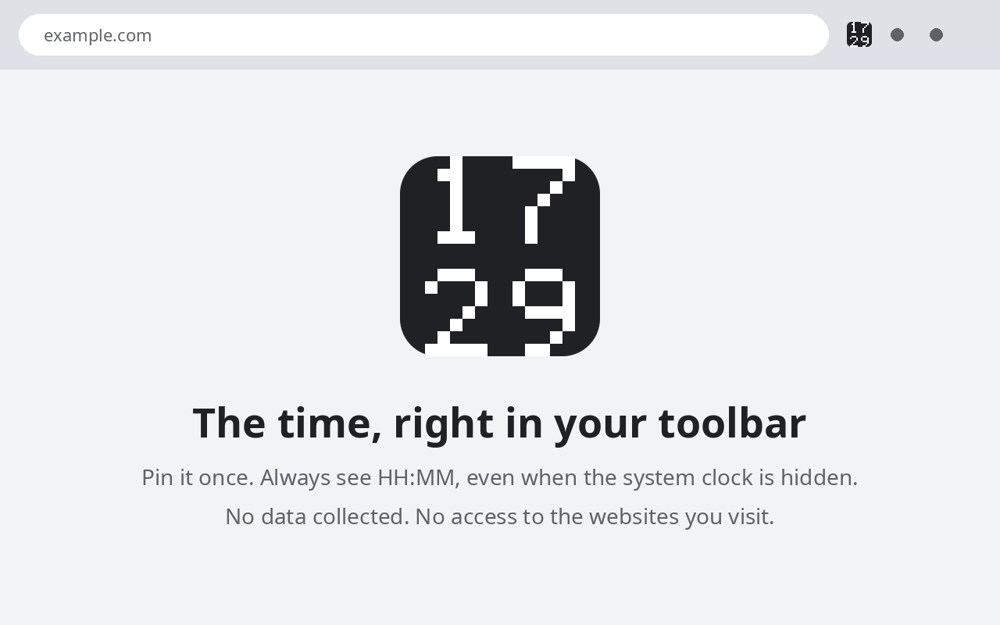

# Clock

A Chrome extension that shows the current time (HH:MM) in the toolbar.



- 24-hour time from your system clock, refreshed every 30 seconds
- Readable on light and dark Chrome themes
- No data collected, no access to websites ([privacy policy](PRIVACY.md))

## Install (development)

1. Open `chrome://extensions` and enable **Developer mode**.
2. Click **Load unpacked** and select this folder.
3. Pin **Clock** from the puzzle-piece menu.

## Package

```
zip -qr clock.zip manifest.json service-worker.js welcome.html welcome.js icons
```

Store listing text and screenshot are in `store/`.
